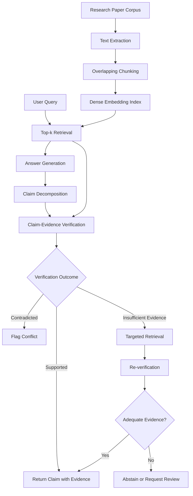

# Proof-Carrying RAG
### Claim-Level Evidence Verification and Selective Repair for Retrieval-Augmented Generation

**Research prototype | RAG · Dense Retrieval · Claim Verification · Evidence Provenance · Selective Abstention**

## 1. Overview

Retrieval-Augmented Generation (RAG) grounds language-model responses in retrieved documents. However, retrieving relevant passages does not guarantee that every generated claim is supported by those passages. Responses may contain unsupported assertions, conflict with source material, or present uncertain information with unwarranted confidence.

**Proof-Carrying RAG** explores a claim-level verification pipeline in which answer claims are evaluated against retrieved evidence, with evidence provenance preserved for inspection. Claims that lack adequate support can trigger targeted retrieval and re-verification; unresolved claims should lead to abstention rather than unsupported assertions.

> A generated claim should be accompanied by traceable evidence and an explicit verification outcome before it is presented as supported.

This repository describes a research prototype and preliminary diagnostic experiments. It does not yet establish that verification or selective repair improves factuality over a vanilla RAG baseline.

## 2. Research Question

Can claim-level evidence verification identify unsupported or contradicted claims in a small research-paper corpus, and can targeted retrieval with selective abstention improve the reliability of document-grounded answers?

The investigation focuses on three subproblems:

- **Evidence retrieval:** Does the retriever return passages relevant to the question and its answer claims?
- **Claim verification:** Can the verifier distinguish support, contradiction, and insufficient evidence?
- **Selective repair:** Can additional retrieval resolve unsupported claims without introducing new unsupported information?

## 3. System Architecture

The pipeline separates retrieval, claim verification, provenance tracking, and selective repair.

*This diagram describes the intended pipeline. Not all components have been validated end to end.*

### Processing stages

1. **Corpus ingestion:** Extract text from five research papers while retaining paper and page provenance.
2. **Chunking:** Split extracted text into overlapping segments to preserve context and provide retrievable evidence units.
3. **Dense retrieval:** Encode chunks and the query in a shared embedding space, then rank candidate passages by similarity.
4. **Answer generation:** Generate an initial answer grounded in retrieved passages. A complete controlled generator-based experiment remains outstanding.
5. **Claim decomposition:** Represent the answer as atomic, declarative propositions suitable for independent verification.
6. **Evidence verification:** Evaluate claim–passage relationships and assign an explicit verification outcome.
7. **Provenance tracking:** Associate each decision with evidence text and stable chunk identifiers.
8. **Selective repair:** Retrieve additional evidence for unresolved claims, verify again, and abstain when adequate support cannot be established.

## 4. Technical Implementation

| Component | Configuration |
|---|---|
| Execution environment | Google Colab |
| Corpus | Five research papers |
| Chunk size | 180, as configured in the notebook |
| Chunk overlap | 40 |
| Embedding model | `sentence-transformers/all-MiniLM-L6-v2` |
| Retrieval strategy | Dense vector similarity, top-\(k\) retrieval |
| Verification design | Gemini Flash via API |
| Evidence unit | Text chunk with paper/page/chunk metadata |
| Repair strategy | Targeted retrieval followed by re-verification |
| Output policy | Supported claim, contradiction flag, or abstention/review |

**Model reproducibility:** Record the exact Gemini model identifier, API version, generation configuration, and verification prompt used in the final experiments. “Gemini Flash” alone is not a sufficiently precise model specification.

### Corpus

The corpus consists of these research papers:

1. *Attention Is All You Need*
2. *Neural Machine Translation by Jointly Learning to Align and Translate*
3. *Retrieval-Augmented Generation for Knowledge-Intensive NLP Tasks*
4. *Dense Passage Retrieval for Open-Domain Question Answering*
5. *Sentence-BERT: Sentence Embeddings using Siamese BERT-Networks*

The corpus provides a compact technical testbed covering attention, neural machine translation, dense retrieval, retrieval-augmented generation, and sentence embeddings.

### Retrieval

Each text chunk is embedded using `all-MiniLM-L6-v2`. Given a query \(q\), the retriever returns the top-\(k\) candidate chunks ranked by embedding similarity.

For normalized embeddings, cosine similarity can be written as:

\[
s(q,d)=\frac{\mathbf{e}_q^\top\mathbf{e}_d}
{\|\mathbf{e}_q\|_2\|\mathbf{e}_d\|_2}.
\]

Similarity measures semantic proximity, not entailment. A highly ranked passage may be relevant to the topic while failing to establish the specific claim being checked.

### Claim-level verification

Let an answer contain claims \(C=\{c_1,\ldots,c_m\}\), and let \(E_i\) denote the retrieved evidence considered for claim \(c_i\).

The verifier evaluates the relationship between a claim and its evidence and produces one of three outcomes:

- **Supported:** The evidence provides adequate support for the claim.
- **Contradicted:** The evidence conflicts with the claim.
- **Insufficient evidence:** The available passages do not establish adequate support or a defensible contradiction.

These labels are semantically distinct. Failure to find support does not, by itself, establish that a claim is false.

Claims should be expressed as declarative propositions rather than passing interrogative questions directly to a textual entailment classifier. Technical formulas, multi-hop reasoning, conflicting passages, and ambiguous statements require special care and may need human review.

### Evidence provenance

Each verification result should preserve:

- Claim identifier and claim text.
- Verification outcome and, where available, confidence or rationale.
- Evidence chunk identifiers.
- Source paper and page numbers.
- Supporting or conflicting evidence excerpts.
- Whether additional retrieval or re-verification was performed.

This provenance enables reviewers to inspect the evidence behind a decision rather than relying exclusively on a model-generated explanation.

## 5. Selective Repair Strategy

Selective repair is intended to avoid regenerating the entire answer when only a subset of claims is unresolved.

For each claim \(c_i\):

1. Verify the claim against the initially retrieved evidence.
2. Retain supported claims together with their evidence references.
3. Flag contradicted claims for conflict handling rather than silently rewriting them as true.
4. Trigger targeted retrieval for claims with insufficient evidence.
5. Re-evaluate the claim against the expanded evidence set.
6. Return the claim only if the evidence satisfies the verification policy; otherwise, abstain or request review.

A repair operation should not automatically mark a claim as supported just because a second model call returns a favorable label. The additional evidence must independently justify the decision.

The selective-repair policy remains a design objective until evaluated through controlled experiments.

## 6. Evaluation Protocol

The preliminary work includes a 30-question retrieval benchmark, an eight-claim verification pilot, and a seven-question abstention diagnostic. These datasets are small and include provisional or manually assigned reference labels.

### Retrieval metrics

**Hit Rate@k** measures whether at least one relevant passage appears among the top-\(k\) retrieved passages:

\[
\operatorname{HitRate@k}
=\frac{1}{N}\sum_{i=1}^{N}
\mathbb{1}[R_i\cap G_i^{(k)}\ne\varnothing],
\]

where \(R_i\) is the set of passages retrieved for query \(i\), and \(G_i^{(k)}\) represents its relevant evidence judgments within the top-\(k\) results.

**Mean Reciprocal Rank (MRR)** measures the average reciprocal rank of the first relevant result:

\[
\operatorname{MRR}
=\frac{1}{N}\sum_{i=1}^{N}\frac{1}{r_i},
\]

where \(r_i\) is the rank of the first relevant passage. If no relevant passage is retrieved, its reciprocal rank is zero.

These metrics measure retrieval quality; they do not measure the factual correctness of generated answers.

### Verification metrics

For a labelled claim-verification benchmark, report:

- Per-class precision, recall, and F1.
- Macro-F1 across supported, contradicted, and insufficient-evidence classes.
- Confusion matrix.
- Evidence attribution accuracy.
- Abstention rate and answer coverage.
- Supported-claim accuracy among claims actually returned.

The verification evaluation should use manually reviewed claim–evidence pairs, a fixed decision policy, and a held-out evaluation set where feasible.

### Controlled comparisons

A future experiment should evaluate the same questions and corpus using:

| System | Purpose |
|---|---|
| Vanilla RAG | Baseline without claim-level verification |
| RAG + verification | Measure the effect of verification and abstention |
| RAG + verification + selective repair | Measure whether targeted retrieval resolves initially unsupported claims |

Use the same corpus, retrieval configuration, evaluation questions, and comparable generation settings across systems. Report factuality, evidence support, answer coverage, latency, and API cost so reliability gains can be assessed alongside operational trade-offs.

## 7. Preliminary Results

The following results are historical pilot observations, not validated benchmark claims.

| Experiment | Preliminary observation | Interpretation |
|---|---|---|
| Retrieval benchmark | Hit Rate@5 = 1.00 | Provisional; relevance labels have not been independently audited |
| Retrieval benchmark | MRR = 0.833 | Provisional; requires audited relevance judgments |
| Eight-claim verification pilot | 6/8 = 75% | Small pilot with provisional reference labels; not a general performance estimate |
| Seven-question abstention diagnostic | 0/7 agreement | Earlier NLI implementation predicted `contradicted` for every intended unanswerable question |

### Diagnostic finding

The abstention diagnostic exposed a formulation and evaluation problem: interrogative questions were supplied directly to an NLI model as hypotheses, and missing evidence was treated as contradiction.

The distinction matters because:

- A claim can be supported by retrieved evidence.
- A claim can conflict with retrieved evidence.
- A claim can remain unresolved because the corpus does not contain adequate evidence.

An always-abstain strategy would match all seven reference labels on this deliberately all-unanswerable subset. This is a trivial subset-specific baseline, not evidence of useful general abstention performance.

**Attribution caveat:** The historical verification observations must remain attributed to the implementation that produced them. They must not be presented as Gemini Flash results unless the same experiments are rerun and verified with Gemini Flash.

## 8. Limitations

- Relevance judgments and verification labels require independent auditing.
- Verification prompts and decision criteria require validation and reproducibility checks.
- Mathematical notation, technical language, and indirect evidence can complicate verification.
- LLM-based decisions may vary with model versions, prompts, and API configuration.
- API quotas, latency, and inference costs can limit repeatability.
- The end-to-end selective-repair strategy has not been validated as a complete system.

## 9. Next Steps

1. Audit and version the benchmark questions, evidence passages, and labels.
2. Reproduce retrieval metrics using fixed settings and verified relevance judgments.
3. Evaluate Gemini Flash on declarative claims across all three verification classes.
4. Define a structured output schema and validate model responses before accepting them.
5. Fix prompts and decision criteria before held-out evaluation.
6. Implement the three-system comparison under matched experimental conditions.
7. Evaluate per-class performance, evidence attribution, abstention, answer coverage, latency, and cost.
8. Perform error analysis on false support, false contradiction, unresolved claims, and failed repairs.
9. Record model identifiers, dependency versions, prompts, parameters, and random seeds where applicable.

## 10. Reproducibility

The current workflow is designed for Google Colab.

1. Mount Google Drive if the research papers are stored there.
2. Place the five PDFs in the configured `data/papers` directory.
3. Install the dependencies used by the notebook.
4. Configure API credentials through Colab Secrets or environment variables; do not commit keys to GitHub.
5. Execute the notebook cells in order.
6. Re-run the benchmark before reporting results as Gemini-based measurements.

The historical metrics above are preliminary and should not be interpreted as independently reproduced results.

## 11. Repository Scope

This project investigates a specific reliability problem in RAG: **how to connect individual generated claims to inspectable evidence and decide when that evidence is insufficient**.

The main contribution at this stage is the prototype design, evidence-provenance workflow, and diagnostic analysis of verification and abstention failure modes. Demonstrating the effectiveness of selective repair remains an open experimental task.

## Portfolio Summary

**Proof-Carrying RAG — Claim-Level Evidence Verification and Selective Repair**

Developed a research prototype for document-grounded question answering over five research papers using dense retrieval, claim-level verification design, and evidence provenance tracking. Investigated the distinction between contradiction and insufficient evidence, analyzed preliminary retrieval and verification failures, and specified a controlled evaluation protocol for verification, abstention, and selective repair. The project emphasizes auditable evidence attribution and systematic evaluation of RAG reliability.
